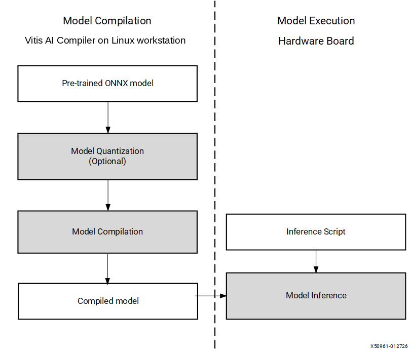

Flow Overview
=============================================================

The Ryzen AI for Linux flow supports models saved in the ONNX format and uses ONNX Runtime
as the mechanism to load, compile, and execute models.

As shown in the diagram, the Ryzen AI for Linux flow consists of three phases:

- **Model Quantization**
- **Model Compilation**
- **Model Execution**

Supported Model Formats and Data Types
--------------------------------------

Ryzen AI Software for Linux in the 1.9 version accepts ONNX models in one of two forms:

- **FP32 (full-precision) models.** Give the compiler your model as-is. The
  compiler automatically converts it to BF16, a lower-precision format that runs
  efficiently on the device. You do not need to quantize the model yourself.

- **INT8-quantized models.** Quantize the model to INT8 first, using AMD Quark. INT8 models are usually smaller and faster, but quantization is an extra step and can affect accuracy.

If you are new to this flow, start with an FP32 model. It is the simplest path
and requires no quantization work.

How BF16 fits in
^^^^^^^^^^^^^^^^^

BF16 is a format the device runs in, not a format you supply. The compiler
produces it for you from your FP32 model. There is no need to convert a model to
BF16 before compiling it, and models that have been quantized to BF16 are not
accepted.

.. note::

   Quantization tools insert **quantize/dequantize (Q/DQ) nodes** into a model to
   mark where precision changes. The Ryzen AI software for Linux supports INT8 Q/DQ
   nodes only. A model containing BF16 Q/DQ nodes cannot be compiled.

   AMD Quark can also store a model's weights at BF16 precision while leaving the
   model itself FP32, with no BF16 Q/DQ nodes added. This is a supported input and
   compiles normally.

.. warning::

   The FP16, MX6, and MX9 data types are **not** supported in the Ryzen AI software for Linux. Some other AMD embedded devices support these data
   types, but models that use them cannot be compiled for Strix in this flow. Use
   an FP32 ONNX model or an INT8-quantized ONNX model instead.

For questions about other data type support, contact your AMD support
representative.  

Supported Model Shapes
-----------------------

ONNX models must have static input and output shapes. Dynamic shapes (for
example, a symbolic batch dimension) are not supported. Fix all dimensions
to concrete values when you export the model to ONNX.

Model Quantization and Compilation
----------------------------------

You perform model quantization and compilation on a Linux workstation. The input
is a pre-trained ONNX model:

- **BF16:** Provide the FP32 model directly. The compiler converts it to BF16
  automatically; no quantization step is needed.
- **INT8:** Quantize the model with AMD Quark first, then compile the quantized
  model. See :doc:`../model_quantization/model_quantization`.

The model is then compiled by initializing an ONNX Runtime inference session
with the Vitis AI Execution Provider, which analyzes the model, determines the
subgraphs to run on the NPU, compiles them, and generates the necessary binary
files. See :doc:`../model_compilation/compiling`.

Model Execution Options
-----------------------

For model execution, Ryzen AI Software for Linux supports the following runtime options:

- **ONNX Runtime Python APIs**: Ideal for prototyping, rapid development, and
  Python-based applications
- **ONNX Runtime C++ APIs**: For performance-critical applications requiring
  C++ integration

Model execution is performed on the target hardware board. You copy the compiled
model to the board's Linux filesystem and deploy it using your chosen runtime.

The following sections of this user guide provide detailed information about all these
phases.

