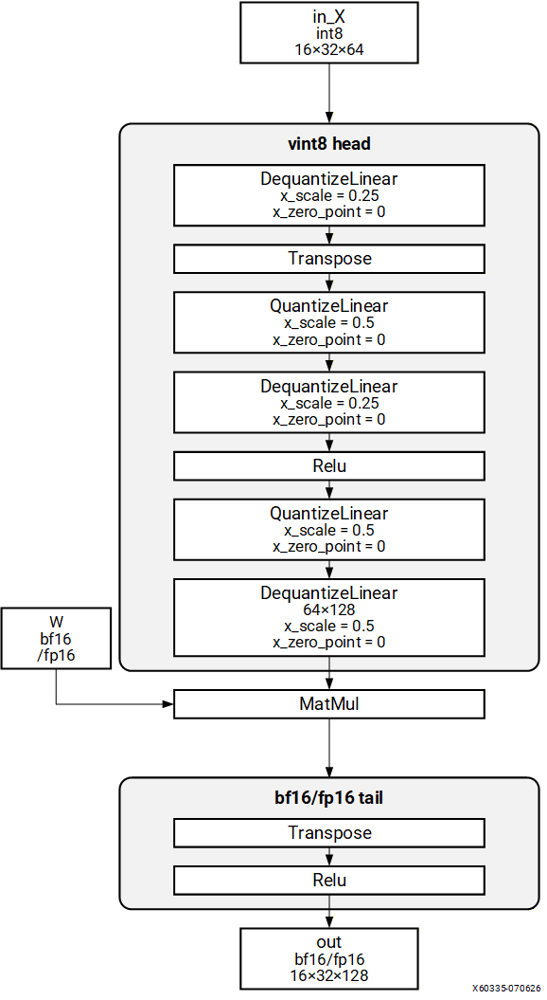
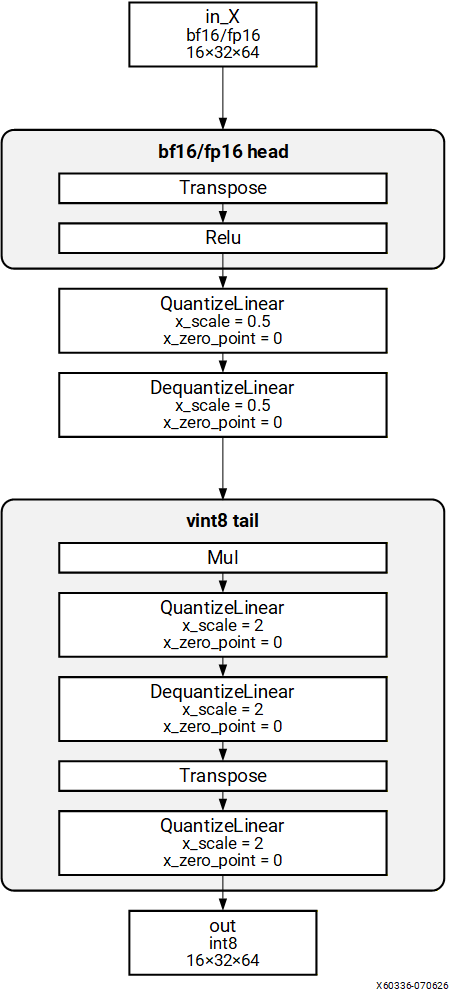
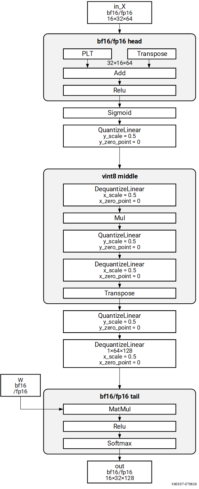
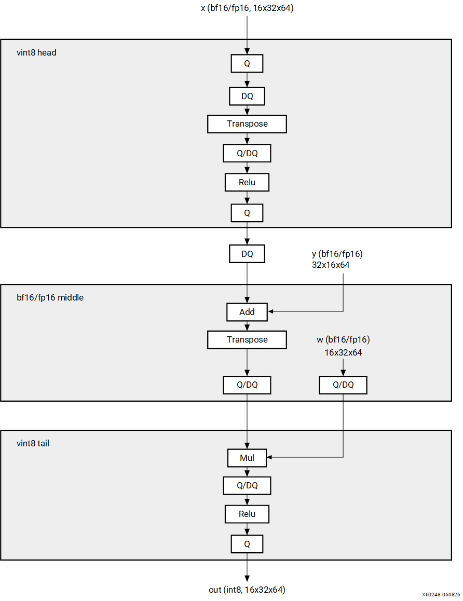
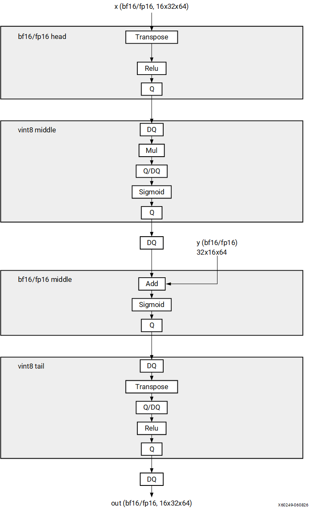
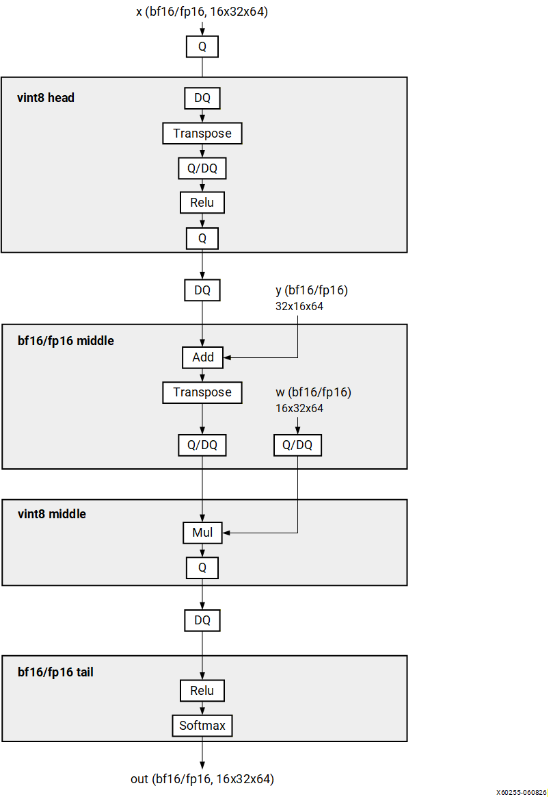

Mixed Precision Compilation
============================

Overview
--------

When quantizing models to INT8, certain operations lose unacceptable accuracy and must fall back to the CPU for execution in FP32. This creates performance bottlenecks from data transfer overhead between the NPU and CPU, and increases power consumption.

Mixed precision compilation enables the AMD Vitis™ AI compiler to execute models with both quantized (VINT8) and floating-point operations entirely on the NPU. The compiler automatically converts FP32 sections excluded from quantization to BF16, eliminating CPU fallback while preserving model accuracy.

By keeping all operations on the NPU, mixed precision reduces latency from data transfers, decreases memory bandwidth and model footprint compared to FP32, and improves power efficiency.

Prerequisites
-------------

Before using mixed precision compilation, your model must be quantized
with AMD Quark using the VINT8 configuration.

To exclude accuracy-sensitive operations from quantization, use the
``subgraphs_to_exclude`` configuration option. This option targets a
connected sequence of nodes forming a logical processing block, such as
a post-processing or NMS subgraph. The excluded subgraph is compiled to
BF16 by the Vitis AI compiler and runs entirely on the NPU, avoiding CPU
fallback.

.. note::

   AMD Quark also provides a ``nodes_to_exclude`` option, which targets
   individual named nodes rather than connected subgraphs. For mixed
   precision compilation workflows, use ``subgraphs_to_exclude`` to
   exclude entire functional blocks. Use ``nodes_to_exclude`` only when
   a single isolated node must be excluded.

For detailed Quark setup instructions and the full list of supported
configuration options in Ryzen AI Software for Linux flow, see :doc:`Model Quantization <../model_quantization/model_quantization>`.

Use Cases
---------

Mixed precision compilation is designed for models where full INT8 quantization is insufficient. Use this feature when you encounter any of the following scenarios:

Quantization Degrades Accuracy
~~~~~~~~~~~~~~~~~~~~~~~~~~~~~~

Your model experiences unacceptable accuracy loss when fully quantized to INT8. Attention mechanisms, layer normalization, and softmax operations often show significant degradation in INT8 precision. Transformer-based models such as BERT, GPT, and Vision Transformers typically lose accuracy with full quantization, as do multi-modal architectures like CLIP and Flamingo. Profiling might reveal specific layers that require higher precision for acceptable model performance.

Use Quark's ``nodes_to_exclude`` to keep accuracy-sensitive operations in FP32, then compile with mixed precision to convert them to BF16 on the NPU.

CPU Offloading Creates Bottlenecks
~~~~~~~~~~~~~~~~~~~~~~~~~~~~~~~~~~~

Your deployment cannot tolerate the latency or throughput impact of CPU fallback. Profiling might show significant time spent transferring data between NPU and CPU. Real-time inference requirements in autonomous vehicles, robotics, and live video analytics are sensitive to CPU offloading overhead. Throughput-sensitive workloads and batch processing pipelines where the CPU limits performance often see improvements from keeping all operations on the NPU.

Mixed precision eliminates data transfer overhead by running all operations on the NPU while maintaining acceptable accuracy.

Resource-Constrained Deployments
~~~~~~~~~~~~~~~~~~~~~~~~~~~~~~~~~

Your deployment environment benefits from reduced memory and power consumption. Edge devices with limited memory bandwidth, battery-powered applications, and data center deployments optimizing for performance-per-watt benefit from mixed precision. BF16 operations consume half the memory of FP32 while running on the NPU's power-efficient hardware.

When NOT to Use Mixed Precision
~~~~~~~~~~~~~~~~~~~~~~~~~~~~~~~~

Skip mixed precision compilation if your model achieves target accuracy with full INT8 quantization, or if CPU fallback overhead is acceptable for your latency requirements. When experimenting with quantization strategies, start with full INT8 first, then use mixed precision only if necessary.

Basic Configuration
-------------------

Mixed precision compilation converts the FP32 sections excluded from VINT8
quantization to BF16. That conversion is the default:
``enable_f32_to_bf16_conversion`` is enabled, and you do not need to add it
to your configuration file.

Some graph shapes need an additional option. Models with a floating-point
head, or with floating-point sections on both sides of a VINT8 region,
require the power-of-two kernel match listed in the configuration reference.
The pattern sections below give the configuration for each shape.

.. _mixed-precision-configuration-reference:

Configuration Reference
-----------------------

Base Flags
~~~~~~~~~~

.. tabularcolumns:: |>{\raggedright\arraybackslash}p{0.38\linewidth}|>{\raggedright\arraybackslash}p{0.10\linewidth}|>{\raggedright\arraybackslash}p{0.52\linewidth}|

.. list-table::
   :header-rows: 1
   :widths: 38 10 52

   * - Flag
     - Type
     - Model Type and When to Use
   * - ``enable_f32_to_bf16_conversion``
     - boolean
     - For VINT8 + FP32 mixed models (quantized with excluded sections remaining in FP32). Enabled by default. The compiler converts excluded FP32 sections to BF16 during compilation.
   * - ``fe_args: match-power-of-two-quant-kernel=1``
     - string
     - For mixed models with a floating-point head or with floating-point sections around a VINT8 region (Patterns 2–6). Enables the compiler to recognize power-of-two quantization kernels.

Specialized Flags
~~~~~~~~~~~~~~~~~

For Models with Quantized VINT8 GEMM Operations
^^^^^^^^^^^^^^^^^^^^^^^^^^^^^^^^^^^^^^^^^^^^^^^^

Add the following configuration::

    {
      "fe_args": "convert-int8-matmul-to-conv=0"
    }

Understanding how the compiler processes mixed precision models helps you choose the right configuration for your use case.

How It Works
------------

The mixed precision compilation workflow begins with an ONNX model quantized using AMD Quark in VINT8 configuration with excluded FP32 sections.

During compilation, the Vitis AI compiler:

1. Converts FP32 sections to BF16
2. Automatically inserts cast operations to manage precision transitions between INT8 and BF16
3. Optimizes the model for full NPU execution

The compiled model executes entirely on the NPU with automatic precision transitions, eliminating CPU fallback overhead and data transfers. Using 16-bit precision instead of 32-bit for non-quantized sections reduces memory footprint and improves latency, throughput, and power efficiency.

Mixed VINT8 and Floating Point Models
--------------------------------------

Overview
~~~~~~~~

Vitis AI compiler supports mixed-precision models that combine floating-point (fp) and 8-bit integer (vint8) layers in alternating patterns such as ``fp -> vint8 -> fp -> vint8`` or ``vint8 -> fp -> vint8 -> fp``. The compiler automatically converts floating-point layers to BF16.

Understanding Quantization Boundaries
~~~~~~~~~~~~~~~~~~~~~~~~~~~~~~~~~~~~~~

In a mixed-precision model, transitions between vint8 and floating-point regions follow a specific pattern:

.. list-table::
   :header-rows: 1
   :widths: 50 50

   * - Transition
     - Operation
   * - Exiting a vint8 region, entering an fp region
     - Dequantize (DQ)
   * - Exiting an fp region, entering a vint8 region
     - Quantize (Q)

Floating-point operations between vint8 regions always appear in the following structure::

    ... vint8 -> DQ -> [fp operation(s)] -> Q -> vint8 ...

DQ-Q Sequence Interpretation
~~~~~~~~~~~~~~~~~~~~~~~~~~~~~

When the compiler encounters a ``DQ -> [operations] -> Q`` sequence, it cannot easily determine whether the operations represent a vint8 quantized pattern (a single quantized operation with its surrounding DQ/Q wrappers) or an intentional floating-point island (a group of operations deliberately kept in floating-point precision). Both cases look structurally identical to the compiler.

Compiler Resolution Strategy
~~~~~~~~~~~~~~~~~~~~~~~~~~~~~

The compiler applies a simple rule to resolve the ambiguity: **A valid vint8 quantized pattern contains exactly one ONNX-level operation between a DQ and Q pair.** Based on this rule, a single ONNX operation between DQ and Q is treated as vint8 quantized, while more than one ONNX operation is treated as a floating-point island.

Limitation
~~~~~~~~~~

The operation count is performed at the ONNX level, not at the internal TOSA IR level. This is important because some single ONNX operations (such as Softmax) are decomposed into multiple TOSA operations internally, and the compiler needs to correctly recognize these as a single vint8 pattern.

**As a result:** If an intentional floating-point island contains only a single ONNX operation between DQ and Q, the compiler incorrectly classifies it as a vint8 quantized pattern. There is currently no way to distinguish this case from a genuinely quantized operation.

Workaround
~~~~~~~~~~

Ensure that intentional floating-point islands contain more than one ONNX operation so the compiler can correctly identify them.

Pattern Reference
-----------------

The compiler supports six graph patterns for mixed precision models. In each pattern, floating-point sections are compiled to BF16 and run on the NPU. The following table summarizes the six patterns:

Pattern Summary
~~~~~~~~~~~~~~~

.. list-table::
   :header-rows: 1
   :widths: 5 40 25 15 15

   * - #
     - Structure
     - Required Config
     - Input
     - Output
   * - 1
     - VINT8 HEAD -> FP TAIL
     - Default
     - int8
     - bf16, fp32
   * - 2
     - FP HEAD -> VINT8 TAIL
     - "fe_args": "match-power-of-two-quant-kernel=1"
     - bf16, fp32
     - int8
   * - 3
     - FP HEAD -> VINT8 MID -> FP TAIL
     - "fe_args": "match-power-of-two-quant-kernel=1"
     - bf16, fp32
     - bf16, fp32
   * - 4
     - VINT8 HEAD -> FP MID -> VINT8 TAIL
     - "fe_args": "match-power-of-two-quant-kernel=1"
     - int8
     - int8
   * - 5
     - FP HEAD -> VINT8 MID -> FP MID -> VINT8 TAIL
     - "fe_args": "match-power-of-two-quant-kernel=1"
     - bf16, fp32
     - bf16, fp32
   * - 6
     - VINT8 HEAD -> FP MID -> VINT8 MID -> FP TAIL
     - "fe_args": "match-power-of-two-quant-kernel=1"
     - int8
     - bf16, fp32

Pattern 1: VINT8 HEAD -> FP TAIL
~~~~~~~~~~~~~~~~~~~~~~~~~~~~~~~~~

Structure
^^^^^^^^^

   Original Model:  VINT8 HEAD -----------> FP32 TAIL (CPU)
   Compiled Model:  VINT8 HEAD (NPU) -----> BF16 TAIL (NPU)

Description
^^^^^^^^^^^

Quantized model with VINT8 operations at the head and FP32 operations at the tail. The compiler replaces the FP32 tail on the CPU with a BF16 tail on the NPU.

Configuration
^^^^^^^^^^^^^

Default behavior, no special configuration required.

- Input types: int8
- Output types: bf16, fp32 (cast or converted from bf16)

Pattern 2: FP HEAD -> VINT8 TAIL
~~~~~~~~~~~~~~~~~~~~~~~~~~~~~~~~~

Structure
^^^^^^^^^

   Original Model:  FP32 HEAD (CPU) -------> VINT8 TAIL
   Compiled Model:  BF16 HEAD (NPU) ------> VINT8 TAIL (NPU)

Description
^^^^^^^^^^^

Quantized model with FP32 operations at the head and VINT8 operations at the tail. The compiler replaces the FP32 head on the CPU with a BF16 head on the NPU.

Configuration
^^^^^^^^^^^^^

::

    {
      "fe_args": "match-power-of-two-quant-kernel=1"
    }

- Input types: bf16, fp32 (cast or converted to bf16)
- Output types: int8

Pattern 3: FP HEAD -> VINT8 MIDDLE -> FP TAIL
~~~~~~~~~~~~~~~~~~~~~~~~~~~~~~~~~~~~~~~~~~~~~~

Structure
^^^^^^^^^

   Original Model:  FP32 HEAD (CPU) -> VINT8 MIDDLE -> FP32 TAIL (CPU)
   Compiled Model:  BF16 HEAD (NPU) -> VINT8 MIDDLE (NPU) -> BF16 TAIL (NPU)

Description
^^^^^^^^^^^

Quantized model with FP32 operations at the head, VINT8 operations in the middle, and FP32 operations at the tail. The compiler replaces the FP32 head and tail on the CPU with BF16 equivalents on the NPU.

Configuration
^^^^^^^^^^^^^

::

    {
      "fe_args": "match-power-of-two-quant-kernel=1"
    }

- Input types: bf16, fp32 (cast or converted to bf16)
- Output types: bf16, fp32 (cast or converted from bf16)

Pattern 4: VINT8 HEAD -> FP MIDDLE -> VINT8 TAIL
~~~~~~~~~~~~~~~~~~~~~~~~~~~~~~~~~~~~~~~~~~~~~~~~~

Structure
^^^^^^^^^

In the following diagram, ``Q`` denotes QuantizeLinear, ``DQ`` denotes
DequantizeLinear, and ``Q/DQ`` denotes a QuantizeLinear immediately followed
by a DequantizeLinear.

   Original Model:  VINT8 HEAD -> FP32 MIDDLE (CPU) ----> VINT8 TAIL
   Compiled Model:  VINT8 HEAD (NPU) -> BF16 MIDDLE (NPU) -> VINT8 TAIL (NPU)

Description
^^^^^^^^^^^

Quantized model with VINT8 operations at the head, FP32 operations in the middle, and VINT8 operations at the tail. The compiler replaces the FP32 middle section on the CPU with a BF16 middle section on the NPU.

Configuration
^^^^^^^^^^^^^

::

    {
      "fe_args": "match-power-of-two-quant-kernel=1"
    }

- Input types: int8
- Output types: int8

Pattern 5: FP HEAD -> VINT8 MIDDLE -> FP MIDDLE -> VINT8 TAIL
~~~~~~~~~~~~~~~~~~~~~~~~~~~~~~~~~~~~~~~~~~~~~~~~~~~~~~~~~~~~~~

Structure
^^^^^^^^^

In the following diagram, ``Q`` denotes QuantizeLinear, ``DQ`` denotes
DequantizeLinear, and ``Q/DQ`` denotes a QuantizeLinear immediately followed
by a DequantizeLinear.

   Original Model:  FP32 HEAD (CPU) -> VINT8 -> FP32 MIDDLE (CPU) -> VINT8 TAIL
   Compiled Model:  BF16 HEAD (NPU) -> VINT8 (NPU) -> BF16 MIDDLE (NPU) -> VINT8 TAIL (NPU)

Description
^^^^^^^^^^^

Quantized model with FP32 operations at the head, VINT8 operations in the middle(1), FP32 operations in the middle(2), and VINT8 operations at the tail. The compiler replaces the FP32 sections on the CPU with BF16 equivalents on the NPU.

Configuration
^^^^^^^^^^^^^

::

    {
      "fe_args": "match-power-of-two-quant-kernel=1"
    }

- Input types: bf16, fp32 (cast or converted to bf16)
- Output types: bf16, fp32 (cast or converted from bf16)

Pattern 6: VINT8 HEAD -> FP MIDDLE -> VINT8 MIDDLE -> FP TAIL
~~~~~~~~~~~~~~~~~~~~~~~~~~~~~~~~~~~~~~~~~~~~~~~~~~~~~~~~~~~~~~

Structure
^^^^^^^^^

In the following diagram, ``Q`` denotes QuantizeLinear, ``DQ`` denotes
DequantizeLinear, and ``Q/DQ`` denotes a QuantizeLinear immediately followed
by a DequantizeLinear.

   Original Model:  VINT8 HEAD -> FP32 MIDDLE (CPU) -> VINT8 MIDDLE -> FP32 TAIL (CPU)
   Compiled Model:  VINT8 HEAD (NPU) -> BF16 MIDDLE (NPU) -> VINT8 MIDDLE (NPU) -> BF16 TAIL (NPU)

Description
^^^^^^^^^^^

Quantized model with VINT8 operations at the head, FP32 operations in the middle(1), VINT8 operations in the middle(2), and FP32 operations at the tail. The compiler replaces the FP32 sections on the CPU with BF16 equivalents on the NPU.

Configuration
^^^^^^^^^^^^^

::

    {
      "fe_args": "match-power-of-two-quant-kernel=1"
    }

- Input types: int8
- Output types: bf16, fp32 (cast or converted from bf16)

Compilation Report
~~~~~~~~~~~~~~~~~~

After compilation, the compiler generates a report file named ``final-vaiml-pass-summary.txt`` in the directory containing the compiled model (``cache_dir/cache_key``). This report shows the compiled model data type.

.. code-block:: text

    --------- Final Summary of VAIML Pass ----------
    OS: Linux X64
    VAIP commit: a4198fae337079ee501a4201667c2acbb5d4b69d
    Model: yolov8m_tail_non_quant.onnx
    Model signature: e5ada2d7e7da7a9f0459d22717e11935
    Device: stx
    Model data type: float32 and int8 quantized
    Device data type: bfloat16 and int8
    Number of operators in the model: 1182
    GOPs of the model: 84.2089
    Number of operators supported by VAIML: 1182 (100.000%)
    GOPs supported by VAIML: 84.209 (100.000%)
    Number of subgraphs supported by VAIML: 1
    Number of operators offloaded by VAIML: 1182 (100.000%)
    GOPs offloaded by VAIML: 84.209 (100.000%)
    Number of subgraphs offloaded by VAIML: 1
    Number of subgraphs with compilation errors (fall back to CPU): 0
    Number of subgraphs above max number of subgraphs allowed(7): 0 (fall back to CPU)
