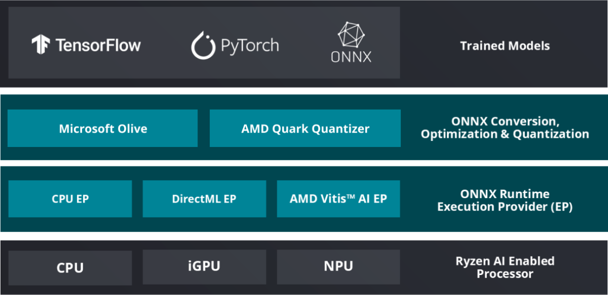

Ryzen AI Software for Linux
===============================================

AMD Ryzen™ AI Software includes the tools and runtime libraries for optimizing and deploying AI inference on AMD Ryzen™ AI powered hardware. Ryzen AI Software for Linux enables applications to run on the neural processing unit (NPU) built in the AMD XDNA™ architecture. This allows developers to build and deploy models trained in PyTorch or TensorFlow and run them directly on hardware powered by Ryzen AI using ONNX Runtime and the Vitis™ AI Execution Provider (EP).

Quick Start
-----------

:ref:`Install and Quickstart guide <install_and_quick_start/AMD-Ryzen™-AI-1.9---Linux-Installation-Guide>`

Development Flow Overview
-------------------------

The Ryzen AI Software for Linux development flow does not require any modifications to the existing model training processes and methods. The pre-trained model can be used as the starting point of the Ryzen AI Software for Linux flow.

The flow has three phases: model quantization (optional), model compilation, and model execution. Floating-point (FP32) models can be compiled directly and are internally converted to bfloat16. For INT8, the model is first quantized with AMD Quark. The compiled model is deployed using ONNX Runtime with either C++ or Python APIs, and the Vitis AI Execution Provider determines which portions of the model run on the NPU.

For details, refer to the :doc:`Development Flow <../development_flow/dev-flow>` page.

License
-------

Ryzen AI is licensed under `MIT License <https://github.com/amd/ryzen-ai-documentation/blob/main/License>`_ . Refer to the `LICENSE File <https://github.com/amd/ryzen-ai-documentation/blob/main/License>`_ for the full license text and copyright notice.
