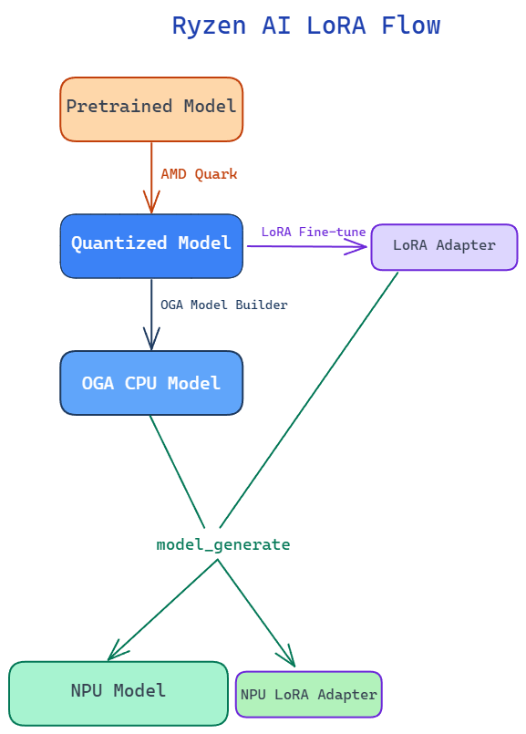

##################
Ryzen AI LoRA flow
##################

Ryzen AI LoRA enables AI PC developers to run an LLM together with LoRA fine-tuned adapters locally on Ryzen AI PCs using the NPU. This brings task-specific and personalized AI capabilities directly to the device while taking advantage of local NPU acceleration and low-power inference. 

A single base LLM can be used with multiple LoRA adapters, allowing applications to dynamically switch adapters at runtime for different users, domains, or tasks without maintaining a separate copy of the full model for each use case. Running the model and adapters locally can reduce dependency on cloud inference, improve responsiveness, keep application data on the device, and enable customized AI experiences on Ryzen AI PCs.

Currently LoRA flow is supported on the following models: Qwen-2.5-4B, Qwen-3-4B, Qwen3.5-4B (text). 

Flow Description
~~~~~~~~~~~~~~~~

For an end-to-end example of the complete fine-tuning flow, including scripts and a
step-by-step walkthrough, see the
`Dynamic LoRA example <https://github.com/amd/RyzenAI-SW/tree/main/LLM-examples/dynamic-lora>`_
in the Ryzen AI SW repository.

- **Quantize the pretrained LLM**: Quantize the pretrained model to INT4 using AMD Quark. For details on the quantization flow,see :ref:`AMD Quark LLM Quantization <llm_quantization>`.
- **LoRA fine-tune the quantized model**: Perform LoRA fine-tuning using the quantized model as the base model to generate a LoRA adapter. For a sample LoRA fine-tuning flow with a Quark-quantized model, see the end-to-end example linked above, which uses Hugging Face `TRL` and `PEFT`.

  - LoRA fine-tuning on the quantized model trains the adapter against the frozen quantized weights, allowing the adapter to adapt to the quantization characteristics of the deployed base model.
  - The maximum supported LoRA rank is currently 128.
- **Compile the model and LoRA adapter for the NPU**: Use the ``model_generate`` tool with the quantized model and LoRA adapter as inputs. ``model_generate`` handles the model conversion internally and generates the compiled NPU model and NPU LoRA adapter for execution on the Ryzen AI NPU. The LoRA adapter is passed through ``--extra_options``, where ``lora_name`` is the name used to activate it at runtime and ``lora_scaling_factor`` must equal the adapter's ``alpha / r``; the scale is applied at compile time, with no runtime dial. ``--mem_optimize`` is optional; it optimizes the model for 16 GB laptop configurations.

.. code::

     model_generate --npu --token_fusion --mem_optimize ^
            --output <npu model folder> ^
            --input <quark quantized model> ^
            --extra_options lora lora_adapter=<adapter>/adapter_model.safetensors lora_name=<adapter name> lora_scaling_factor=<alpha/r>

- **Run inference with LoRA adapters**: Load the compiled NPU model and switch LoRA adapters at runtime by name, as shown below.

.. code::

   import onnxruntime_genai as og
   from ryzenai_onnx_utils import set_active_adapter

   model = og.Model("<npu model folder>")  # loads the base NPU model

   set_active_adapter("<adapter name>")   # activate a compiled adapter by name
   set_active_adapter("base")             # revert to the base model

